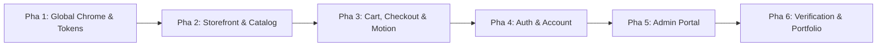

# Kế hoạch Đại tu Giao diện & Tích hợp Micro-interactions (Anti-AI-Slop & Motion Overhaul)

| Trường | Giá trị |
|---|---|
| **Dự án** | ECommerce.Web (.NET 10 MVC + Tailwind CSS) |
| **Mục đích** | Triệt tiêu 100% "AI Slop", đồng bộ chuẩn Minimalist E-Commerce ([docs/DESIGN.md](file:///C:/Users/hieub/source/repos/ECommerce.Web/docs/DESIGN.md)) và thêm chuyển động xúc giác |
| **Phạm vi code** | Chỉ sửa Presentation (Razor Views `.cshtml`, layout, CSS/JS vi mô). **Cấm đổi logic C#, cấm đổi DB, cấm thêm package NuGet** |
| **Bảo vệ chất lượng** | Giữ vững 277/277 Unit Tests, hỗ trợ `prefers-reduced-motion`, chuẩn WCAG 4.5:1 |
| **Thời gian ước tính** | 6 Pha thực thi tuần tự (~3 – 4 giờ) |

---

## 1. Mục tiêu & Nguyên tắc chuyển đổi

### 1.1 Khử triệt để 5 "triệu chứng" AI Slop
1. ❌ **Xóa bỏ màu tím / indigo rực rỡ:** Chuyển toàn bộ sang hệ màu than chì Obsidian & Neutral (`zinc-900` / `zinc-100`), điểm nhấn `amber-600` cho trạng thái/rating.
2. ❌ **Hạ bán kính bo góc:** Xóa bỏ `rounded-3xl` và `rounded-2xl` quá khổ. Chuẩn hóa về `rounded-lg` (8px cho card/modal) và `rounded-md` (6px cho button/input).
3. ❌ **Xóa bóng đổ phát sáng neon:** Thay `shadow-indigo-500/30` và `shadow-2xl` bằng viền 1px sắc sảo (`border-zinc-200 dark:border-zinc-800`) kết hợp `shadow-sm`.
4. ❌ **Bỏ khẩu hiệu sáo rỗng & icon emoji:** Xóa các câu từ do AI bịa (*"Đỉnh cao công nghệ"*, *"Ra mắt bộ sưu tập..."*), xóa icon lấp lánh `fa-sparkles`.
5. ❌ **Tăng mật độ thông tin (Data Density):** Thu gọn padding thừa, hiển thị nhiều sản phẩm và dòng dữ liệu hơn trên màn hình.

### 1.2 Hệ thống Chuyển động Chức năng (Functional Motion)
* **Snappy Timing:** Mọi animation chỉ kéo dài từ **100ms – 200ms**. Không làm người dùng phải chờ đợi.
* **Tactile Press:** Mọi nút bấm và control đều có phản hồi bấm xúc giác `active:scale-[0.98]`.
* **Internal Zoom:** Ảnh sản phẩm zoom nhẹ `scale-105` bên trong khung `overflow-hidden` khi hover, không làm giật card.
* **AutoAnimate:** Tích hợp thư viện siêu nhẹ `@formkit/auto-animate` (2KB) giúp danh sách giỏ hàng trượt êm ái khi thêm/xóa/cập nhật.

---

## 2. Lộ trình thực thi chi tiết (6 Pha)

---

### Pha 1: Nền tảng Tokens & Layouts Chung (Global Chrome)
**Mục tiêu:** Định hình khung xương của toàn bộ website, đưa bảng màu và font chữ vào `_Layout.cshtml` và `_AdminLayout.cshtml`.

1. **`Views/Shared/_Layout.cshtml`:**
   - Cấu hình Tailwind trong thẻ `<script>`:
     - `colors.primary`: `#18181B` (Zinc 900)
     - `colors.accent`: `#D97706` (Amber 600)
     - `transitionTimingFunction.spring`: `cubic-bezier(0.16, 1, 0.3, 1)`
   - Thiết kế lại **Navbar**: Nền trắng/zinc-900 phẳng, logo chữ đậm sắc nét, thanh tìm kiếm tối giản có phím tắt, icon giỏ hàng có badge count tinh gọn.
   - Thiết kế lại **Footer**: Chuyển từ footer dài dòng sang footer 4 cột tinh tế phong cách Minimalist (Sản phẩm, Hỗ trợ, Chính sách, Thanh toán an toàn).
2. **`Views/Shared/_LoginPartial.cshtml`:**
   - Dropdown tài khoản gọn gàng, viền mảnh, hiệu ứng hover nhẹ.
3. **Nghiệm thu Pha 1:** Header & Footer hiển thị đồng bộ ở mọi trang; Dark mode hoạt động trơn tru; build không lỗi.

---

### Pha 2: Storefront, Danh mục & Chi tiết Sản phẩm
**Mục tiêu:** Biến trải nghiệm duyệt sản phẩm thành catalog thương mại điện tử chuyên nghiệp (chuẩn Medusa/Zara).

1. **`Views/Home/Index.cshtml`:**
   - Hoàn thiện pilot: Tinh chỉnh micro-interactions cho các nút bấm (`active:scale-[0.98]`), tối ưu hóa hiển thị responsive trên mobile 375px.
2. **`Views/Products/Index.cshtml` (Catalog & Filter):**
   - Thay thanh tìm kiếm to đùng bằng thanh search gọn gàng kèm nút clear.
   - Sidebar bộ lọc danh mục: Thiết kế dạng danh sách dọc phẳng, đếm số lượng sản phẩm, highlight danh mục đang chọn bằng viền trái hoặc badge xám tinh tế.
   - Lưới sản phẩm: Đồng bộ card `rounded-lg` viền 1px như trang chủ.
3. **`Views/Products/Details.cshtml` (Chi tiết sản phẩm):**
   - Khung ảnh sản phẩm lớn ở bên trái với nền `bg-zinc-50 dark:bg-zinc-800/40` và hover zoom nhẹ.
   - Khối thông tin bên phải: Tiêu đề rõ ràng, cụm rating sao vàng (`text-amber-500`), giá tiền in đậm nổi bật.
   - Bộ chọn số lượng (Quantity Selector): Thiết kế nút `+` và `-` dạng phím bấm vuông bo nhẹ (`active:scale-95`).
   - Nút "Thêm vào giỏ": To, nổi bật, màu đen than chì (`bg-zinc-900 text-white`).
   - Khu vực đánh giá (Reviews): Bố cục từng review rõ ràng, huy hiệu "Đã mua hàng" (Verified Buyer) thanh lịch.
4. **Nghiệm thu Pha 2:** Trang danh mục và chi tiết sản phẩm hiển thị sắc nét, hình ảnh nổi bật, thêm vào giỏ hoạt động chuẩn.

---

### Pha 3: Giỏ hàng, Luồng Thanh toán & Chuyển động Động
**Mục tiêu:** Luồng checkout mượt mà, loại bỏ mọi sự gián đoạn thị giác.

1. **`Views/Cart/Index.cshtml` (Giỏ hàng):**
   - Nhúng script `@formkit/auto-animate` từ CDN (2KB, không phụ thuộc package).
   - Áp dụng `auto-animate` cho bảng danh sách sản phẩm: Khi khách tăng/giảm số lượng hoặc bấm xóa, item tự động trượt êm ái thay vì giật layout.
   - Khối tóm tắt thanh toán: Card bên phải gọn gàng, liệt kê tạm tính, giảm giá coupon, tổng tiền rõ ràng.
2. **`Views/Cart/CheckoutPreview.cshtml` (Xác nhận đặt hàng):**
   - Giữ nguyên các guard logic của VNPay (T1) và form input.
   - Tút lại giao diện: Sổ địa chỉ dạng card chọn, radio COD phẳng viền mảnh, tóm tắt đơn hàng thanh lịch.
   - Nút "Xác nhận Đặt Hàng": Nút chắc chắn, hiệu ứng bấm xúc giác, thông điệp bảo đảm giao dịch an toàn.
3. **`Views/Payment/Result.cshtml`:**
   - Giao diện thông báo kết quả thanh toán tinh giản, icon checkmark xanh lá/đỏ tinh gọn, nút xem đơn hàng.
4. **Nghiệm thu Pha 3:** Thử nghiệm thêm sản phẩm vào giỏ, xóa món đồ thấy hiệu ứng trượt mượt mà; đặt hàng COD thành công không lỗi.

---

### Pha 4: Xác thực & Quản lý Tài khoản Khách hàng
**Mục tiêu:** Các trang Auth và Profile đạt tính chuyên nghiệp cao.

1. **`Views/Account/Login.cshtml` & `Register.cshtml`:**
   - Xóa bỏ các hình nền công nghệ mờ mịt phía sau.
   - Khung đăng nhập căn giữa trang, viền mảnh `border-zinc-200`, form input có focus ring màu xám đen (`focus:ring-zinc-900`).
   - Liên kết quên mật khẩu / đăng ký chuyển sang màu trung tính.
2. **`Views/Orders/Index.cshtml` & `Details.cshtml`:**
   - Danh sách đơn hàng: Bảng đơn tinh gọn, badge trạng thái (Pending, Processing, Completed, Cancelled) dùng màu pastel dịu mắt.
   - Chi tiết đơn: Timeline các bước xử lý đơn hàng dạng thanh ngang tối giản (Linear Stepper).
3. **`Views/Profile/Index.cshtml` & `_AddressForm.cshtml`:**
   - Giao diện quản lý sổ địa chỉ sạch sẽ, form thêm/sửa địa chỉ dạng modal hoặc inline card tinh tế.
4. **Nghiệm thu Pha 4:** Đăng nhập, xem lịch sử đơn hàng, xem timeline đơn chuẩn xác.

---

### Pha 5: Trang Quản trị (Admin Portal)
**Mục tiêu:** Chuyển đổi toàn bộ Admin Portal theo phong cách Data-Dense Dashboard (chuẩn Tabler / Shadcn Admin).

1. **`Views/Admin/Index.cshtml` (Dashboard):**
   - 4 thẻ KPI chính: Bỏ các màu nền lòe loẹt, chuyển sang card trắng/zinc-900 viền mảnh, số liệu lớn in đậm, nhãn phụ sắc nét.
   - Bảng đơn hàng gần đây & Cảnh báo tồn kho: Tối ưu khoảng cách dòng (`py-2.5`), font chữ mono cho mã đơn và giá tiền.
2. **`Views/Admin/Products.cshtml` & `ProductForm.cshtml`:**
   - Bảng sản phẩm gọn gàng, thumbnail vuông 40x40px bo nhẹ, nút thao tác (sửa/xóa/đổi trạng thái) nhỏ gọn.
3. **`Views/Admin/Orders.cshtml` & `OrderDetails.cshtml`:**
   - Tab chuyển trạng thái đơn hàng phẳng, bảng dữ liệu đơn hàng dễ đọc.
4. **Các trang phụ trợ (`Categories.cshtml`, `Coupons.cshtml`, `Reviews.cshtml`, `ShippingMethods.cshtml`):**
   - Đồng bộ hóa toàn bộ bảng dữ liệu và form nhập liệu theo cùng một ngôn ngữ thiết kế.
5. **Nghiệm thu Pha 5:** Toàn bộ Admin Portal đồng bộ, mật độ dữ liệu cao, không còn bất kỳ chi tiết đồ chơi nào.

---

### Pha 6: Kiểm chứng Toàn diện, Accessibility & Đóng gói Portfolio
**Mục tiêu:** Đảm bảo độ tin cậy kỹ thuật và chuẩn bị ảnh chụp minh chứng cho CV.

1. **Kiểm tra Kỹ thuật:**
   - Chạy `dotnet test --nologo -v q` ➔ Bắt buộc đạt **277/277 PASS**.
   - Chạy `dotnet build` ➔ **0 lỗi, 0 cảnh báo**.
2. **Kiểm tra Giao diện & Trợ năng (Accessibility):**
   - Kiểm tra chế độ `prefers-reduced-motion`: Đảm bảo khi bật cài đặt này trong OS/Browser, web tự động vô hiệu hóa transition transform.
   - Kiểm tra Responsive trên các độ phân giải: Mobile (375px), Tablet (768px), Desktop (1280px).
   - Kiểm tra độ tương phản văn bản đạt chuẩn WCAG AA (>= 4.5:1).
3. **Chụp ảnh Portfolio mới:**
   - Chụp lại 5 ảnh màn hình thực tế:
     - `screenshots/home.png` (Trang chủ mới)
     - `screenshots/catalog.png` (Trang danh mục & bộ lọc)
     - `screenshots/product-detail.png` (Trang chi tiết sản phẩm)
     - `screenshots/checkout.png` (Trang giỏ hàng & checkout)
     - `screenshots/admin-dashboard.png` (Trang admin chuyên nghiệp)
   - Nhúng trực tiếp vào `README.md`.

---

## 3. Quản lý rủi ro & Kế hoạch lùi (Rollback Strategy)

| Rủi ro tiềm ẩn | Mức độ | Biện pháp ngăn chặn & Xử lý |
|---|:---:|---|
| Vỡ CSRF Token hoặc mất trường input hidden trong form | Cao | Tuyệt đối giữ nguyên các thẻ `@Html.AntiForgeryToken()`, `<input type="hidden" .../>` và thuộc tính `asp-for`. Chỉ sửa class CSS bọc ngoài. |
| AutoAnimate làm gián đoạn submit form giỏ hàng | Thấp | Chỉ bọc auto-animate trên `<tbody>` hoặc container danh sách hiển thị, không bọc ngoài form tổng thể. |
| Màu chữ tương phản yếu trong Dark Mode | Trung bình | Kiểm tra độc lập light mode (`text-zinc-900`) và dark mode (`dark:text-zinc-100`). Không dựa vào class opacity mờ mịt. |

---

## 4. Trạng thái bắt đầu đề xuất

Kế hoạch đã sẵn sàng để thực thi. Chúng ta có thể bắt đầu ngay với **Pha 1: Cấu hình Tokens & Khung Layouts Chung (`_Layout.cshtml`)**.
